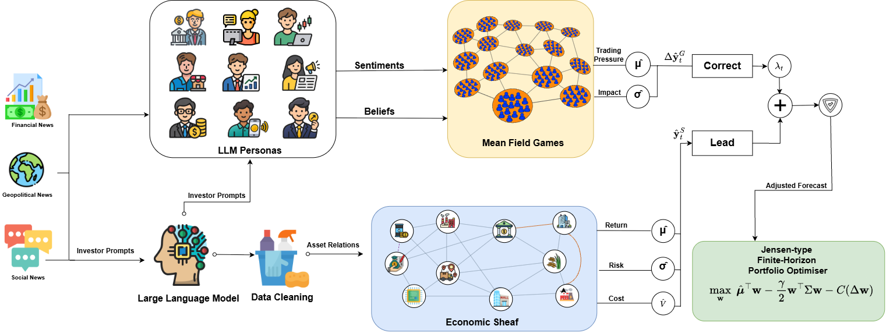

# FinFlock

FinFlock combines financial news, a typed economic sheaf, investor personas, and a mean-field trading game to construct cost-aware portfolios. the sheaf models how a news shock moves through asset relationships, while the persona branch models investor beliefs and trading pressure. the final framework combines both forecasts and applies portfolio constraints and transaction costs.

## architecture



## Tessera: a dataset contribution

Tessera is a central contribution of FinFlock: a point-in-time news-event dataset that brings company disclosures, official geopolitical events, archived news, and investor discussion into one event-linked representation. its design records how an availability timestamp was obtained, applies conservative timing when the source cannot establish an exact instant, and preserves unsupported or unlinked records without inventing company labels.

| Part | Sources | Items | Events | Train / test items | Avg. text | Availability-time basis | Asset links / exposure | Historical release assessment (3 Nov 2026) |
| --- | --- | ---: | ---: | ---: | --- | --- | --- | --- |
| **Company filings** | SEC 8-K; foreign 6-K/20-F (14 event families) | 168,316 | 167,967 | 137,657 / 30,366 | 4.5 KB; 6,000-character excerpt cap | **100% exact** SEC acceptance timestamps, to the second | 100% supported company links | IDs and times cleared; text unresolved at assessment |
| **Official geopolitical** | Federal Register, OFAC, GDELT 1.0, Wikinews (9 families) | 18,127 | 17,971 | 12,675 / 5,404 | 0.4 KB | **74.8% exact**; remaining items use conservative date-only timing | 53% country; 20% commodity; no company labels | Full metadata and text cleared |
| **Geopolitical news supplement** | 11 news archives, including NYT and Yahoo Finance | 14,263 | 14,263 | 9,856 / 4,402 | 1.28 KB; 46.4% below 200 characters | Date-only policy; edit history unavailable | 33.3% company exposure, unaudited; 48.1% strictly country-only exposure | Most publisher text restricted; 23 Wikinews copies cleared |
| **Social** | Reddit: r/investing, r/stocks, r/StockMarket, r/wallstreetbets | 231,111 | 231,111 | 182,332 / 47,567 | 0.6 KB | Date-only policy; source clock claims are not promoted to exact | 18.5% supported company links; 68.4% have no recorded pin | Permission unresolved at assessment |
| **Total** | **21 feeds; 25 event families** | **431,817** | **431,312** | **342,520 / 87,739** | **923.6 MB total UTF-8 text** | **42.1% exact** | **3,886 company CIKs** | **18,150 full-text records (4.2%); 186,466 metadata records (43.2%) cleared at assessment** |

**Table 1. Tessera news-event dataset, 2015-01-01 to 2025-12-31 (UTC).** train contains items assigned to availability sessions on or before 2023-12-31; the held-out test covers 2024-01-09 to 2025-12-31 after a five-session embargo. the 1,558 embargo items are included in the item totals and omitted from the train/test column. “exact” identifies an official SEC acceptance timestamp or Federal Register public-inspection timestamp, rather than an unverified clock claim. date-only items become available at the start of the next UTC day; GDELT uses a three-day delay. the 431,312 events comprise 417,049 core events and 14,263 distinct supplemental event IDs. text sizes describe the frozen source text before anonymization, in decimal bytes: 905.3 MB for the three core parts plus 18.3 MB for the supplement. the country-day panel adds 944,230 structured rows across 47 countries and five GDELT event families.

the frozen package reports no events, URLs, or source pointers crossing the training/held-out boundary and no SEC near-duplicates crossing that boundary under its specified matching rule. recurring official-document templates are flagged instead of being silently treated as unrelated text. these checks describe dataset construction, not model performance.

FinFlock uses a separate experiment split inside Tessera: 2015–2021 for fitting, 2022–2023 for the framework holdout, and a sealed 2024–2025 evaluation window. Tessera's package test partition begins on 9 January 2024 after its embargo; the framework's sealed interval is subject to that package boundary.

**Release-status context.** the last column preserves the historical source assessment, not a claim that every included source shares one license. full-package redistribution approval was subsequently confirmed by the uploader, and the current repository includes all four components. historical rights fields remain as provenance, and source attribution is retained. the full-text and metadata figures overlap; they are not additive.

the [Tessera dataset README](dataset/tessera/README.md) documents source counts, record definitions, timestamps, split guards, asset-link coverage, validation checks, coverage limitations, and loading commands. the dataset files and [checksum manifest](dataset/tessera/MANIFEST.json) are included in this repository.

## repository structure

the experiment entry points are grouped by dataset, model, and stage. each stage calls the shared implementation, so the scientific code stays consistent across runs.

```text
finflock/
├── databucket1/
│   ├── olmo/       ── sheaf/, personas/, final_framework/
│   ├── gemma/      ── sheaf/, personas/, final_framework/
│   └── llama/      ── sheaf/, personas/, final_framework/
├── tessera/
│   ├── olmo/       ── sheaf/, personas/, final_framework/
│   ├── gemma/      ── sheaf/, personas/, final_framework/
│   └── llama/      ── sheaf/, personas/, final_framework/
├── databucket3/
│   ├── olmo/       ── sheaf/, personas/, final_framework/
│   ├── gemma/      ── sheaf/, personas/, final_framework/
│   └── llama/      ── sheaf/, personas/, final_framework/
├── finflock/          # shared scientific implementation
├── reader2/        # news reader, validation, and shard scheduling
├── pilot/          # reader prompts and supporting inference code
├── config/         # experiment settings and small lookup tables
├── dataset/tessera/ # anonymized Tessera input dataset and standalone loader
├── scripts/        # build, merge, freeze, and input conversion tools
├── tests/          # synthetic tests of numerical methods and pipeline behavior
├── assets/architecture.png
├── run_pipeline.py
└── pyproject.toml
```

each stage directory contains `run.py`. `sheaf/reader.py` runs the news reader before cleaning and fitting the sheaf. `final_framework` contains the entry point for the sheaf, persona-game, and merged forecast comparisons.

## models and datasets

| directory | model identifier in configuration | checkpoint |
| --- | --- | --- |
| `olmo` | `llm2` | `allenai/Olmo-3-7B-Instruct` |
| `gemma` | `llm1` | `google/gemma-4-12B-it-qat-w4a16-ct` |
| `llama` | `llm3` | `meta-llama/Llama-3.1-8B-Instruct` |

gemma uses the quantized checkpoint with its full-precision fallback configured in `config/engine.yaml`.

| experiment directory | internal dataset identifier | description |
| --- | --- | --- |
| `databucket1` | `db1` | financial news with geopolitical and social supplements |
| `tessera` | `tessera` | point-in-time financial news package |
| `databucket3` | `db3` | financial and general news with social posts |

tessera's actual dataset files are included in [`dataset/tessera/`](dataset/tessera/), alongside a standalone loader and file checksums. the other datasets and model weights are supplied separately, and personal dataset-hosting links are omitted. the experiment loaders and preprocessing code are in `finflock/data/` and `finflock/stage/`. experiment windows are in `config/windows.yaml` and `config/clean.yaml`.

the nine dataset/model combinations are supported entry points. the four additional final-build configurations use their dataset's existing time windows and paths; their presence does not assert that those experiments were completed. tessera's gemma and llama readers retain the configured hash-based subset selection in `reader2/settings.py`.

## installation

use python 3.11 or later, from this repository's root:

```bash
python -m pip install -e '.[dev]'
```

for model inference on a compatible CUDA GPU:

```bash
python -m pip install -e '.[gpu]'
```

stage model weights locally using `FINFLOCK_WEIGHTS_ROOT`, or supply any required access credential through the process environment. credentials belong outside source files. GPU memory requirements and parallelism are set in `config/engine.yaml`; full experiment runs are computationally intensive.

## local inputs

`--root` points to a local working tree with `dataset/`, `store/`, and generated `outputs/` folders. paths for each final build are declared in `config/clean.yaml`. provide the reader tape, staged units, asset links, market prices, and factor table for that run. the persona branch also needs investor skeletons, biography inputs, and reader bundles; the merged framework reads the matching persona bundles.

the news reader accepts `--input-root` containing a prepared reader pack: `RUN_PLAN.json`, per-dataset `data/<dataset>/units.parquet`, alias tables, and matching local model inputs. its schema and integrity checks are implemented in `reader2/plan.py` and `reader2/session.py`. persona inputs are resolved by `finflock/stage/run_stage.py` and `finflock/stage/persona_stage.py`.

generate tapes, manifests, fitted parameters, and freeze records from this source and configuration before running later stages. configuration identifiers and hashes must match throughout the pipeline. existing freeze records from a different configuration cannot be reused.

## running the stages

show the common options:

```bash
python tessera/olmo/sheaf/run.py --help
```

run the reader with local prepared inputs:

```bash
python tessera/olmo/sheaf/reader.py --input-root /path/to/reader-pack
```

run persona inference with locally staged market, reader, and biography inputs:

```bash
python tessera/olmo/personas/run.py --input-root /path/to/persona-inputs
```

check the sheaf's declared input paths, then run cleaning and sheaf fitting:

```bash
python tessera/olmo/sheaf/run.py --root /path/to/local-tree --check-inputs
python tessera/olmo/sheaf/run.py --root /path/to/local-tree
```

the final framework requires matching generated build artifacts and freeze records. create those with the freeze tools under `scripts/` after preparing the inputs and development fit, then run:

```bash
python tessera/olmo/final_framework/run.py --root /path/to/local-tree
```

replace `tessera` and `olmo` in these commands with the desired directory names. use `--out` to choose a generated-output folder and `--config` to supply an alternate configuration directory. the lower-level build scripts expose additional fitting and sharding options.

## implementation

| component | source |
| --- | --- |
| news prompts, inference, and validation | `reader2/`, `pilot/`, `finflock/reader/` |
| cleaning and point-in-time controls | `finflock/clean/`, `finflock/common/timing.py` |
| economic graph and sheaf fitting | `finflock/road1/`, `finflock/build/` |
| investor panels and persona answers | `finflock/personas/`, `finflock/stage/persona_build.py` |
| mean-field game | `finflock/mfg/` |
| forecast combination and final framework | `finflock/framework/` |
| costs, constraints, and portfolio execution | `finflock/portfolio/` |

## validation

```bash
python -m pytest
```

the tests generate small synthetic fixtures in temporary folders. full pipeline replication and GPU inference require the remaining local inputs and suitable hardware. this release includes Tessera, the architecture image, and configuration constants; saved notebook executions, experiment results, model weights, and checkpoint bundles are excluded.
